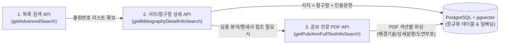

# 03. 전문(Full-Text) PDF 및 도면 조회 API 명세 (`FullText & Image API`)

서지 상세 API(`getBibliographyDetailInfoSearch`)에는 **요약(Abstract)**과 **청구항(Claims)**만 포함되며, 명세서 본문인 **[발명의 배경이 되는 기술]**, **[해결하려는 과제]**, **[발명을 실시하기 위한 구체적인 내용]**, **[부호의 설명]**은 공보 전문(Full-Text)에서 가져와야 합니다.

---

## 1. 공개/등록 공보 전문 PDF 경로 조회

### 1.1 공개 전문 경로 조회 (`getPubFullTextInfoSearch`)
* **Endpoint**: `GET http://plus.kipris.or.kr/kipo-api/kipi/patUtiModInfoSearchSevice/getPubFullTextInfoSearch`
* **용도**: 공개된 특허의 공개공보 전문 PDF 다운로드 URL 및 파일명을 조회합니다.
* **요청 파라미터**:
  * `applicationNumber` (`string`, 필수): 13자리 출원번호
  * `ServiceKey` (`string`, 필수): 오픈 API 인증키

### 1.2 등록 공보 전문 경로 조회 (`getAnnFullTextInfoSearch`)
* **Endpoint**: `GET http://plus.kipris.or.kr/kipo-api/kipi/patUtiModInfoSearchSevice/getAnnFullTextInfoSearch`
* **용도**: 등록 완료된 특허의 등록공보 전문 PDF 다운로드 URL 및 파일명을 조회합니다.
* **요청 파라미터**:
  * `applicationNumber` (`string`, 필수): 13자리 출원번호
  * `ServiceKey` (`string`, 필수): 오픈 API 인증키

### 1.3 응답 XML 구조

```xml
<response>
    <header>
        <successYN>Y</successYN>
        <resultCode>00</resultCode>
        <resultMsg>NORMAL SERVICE.</resultMsg>
    </header>
    <body>
        <item>
            <docName>1020240035123.pdf</docName>
            <path>http://plus.kipris.or.kr/kiprisplusws/fileToss.jsp?arg=ed43a0609e94d6e2...</path>
        </item>
    </body>
</response>
```

| XML 태그명 | 설명 | 활용 방안 |
| :--- | :--- | :--- |
| `docName` | 공보 PDF 파일명 | 로컬/클라우드 스토리지 저장 파일명으로 활용 |
| `path` | 공보 전문 PDF 직접 다운로드 URL | C# 백엔드에서 스트림 다운로드 후 PDF 텍스트/도면 파싱 수행 |

---

## 2. PASO AI 데이터 수집 및 가공 파이프라인 설계 기준

KIPRIS API의 특성에 맞춰 **PASO AI**는 다음과 같이 2단계(Two-Tier) 수집 전략을 사용합니다.



1. **1차 수집 (경량·고속 - PASO Lens 중심)**
   * `getAdvancedSearch`로 대상 특허군 식별
   * `getBibliographyDetailInfoSearch`로 **서지 요약 + 청구항 전체(`claimInfoArray`) + IPC/CPC + 출원인 + 인용문헌 + 법적상태**를 수집하여 RDB 및 Vector DB에 저장
2. **2차 수집 (심층·온디맨드 - PASO Docs 중심)**
   * 사용자가 특정 선행특허의 상세 실시예, 도면 부호 설명, 과제 해결 수단을 참조해 명세서나 의견서를 작성할 때 `getAnnFullTextInfoSearch` / `getPubFullTextInfoSearch`의 `path`에서 PDF를 내려받아 섹션별로 파싱 후 저장
